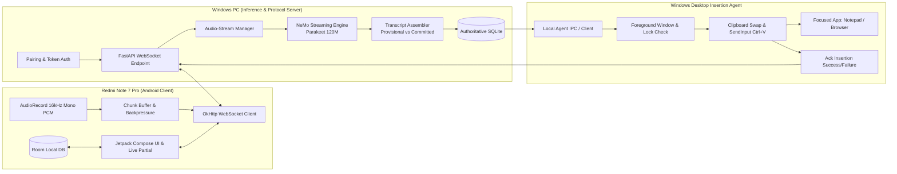

# PhoneMic LAN 🎙️

> **Real-Time Android-to-Windows Voice Typing powered by Local NVIDIA NeMo Streaming ASR**

PhoneMic LAN turns your Android smartphone (such as a Redmi Note 7 Pro) into a zero-latency, local-network voice typing microphone for your Windows 11 PC. Audio is streamed over a secure LAN WebSocket connection to a local inference server running NVIDIA NeMo streaming models, and the finalized transcription is automatically typed directly into your focused application (Notepad, browser, IDE, Word, Discord) via native Win32 `SendInput`.

**Zero Cloud Uploads • 100% Private & Offline • Optimized for 4GB VRAM NVIDIA GPUs**

---

## 🏗️ Architecture



---

## ⚡ Hardware & Model Feasibility (4GB VRAM)

- **Target GPU:** NVIDIA GeForce GTX 1650 (Turing TU117, Compute Capability 7.5, 4096 MiB VRAM).
- **Usable VRAM:** ~3050 MiB after desktop display server overhead.
- **Primary Model (Candidate A):** `nvidia/parakeet_realtime_eou_120m-v1` (~120M parameters, ~240-450MB FP16).
  - *Feasibility:* Fits with ample headroom for streaming encoder state caches and CUDA context.
- **Secondary Model (Candidate B):** `nvidia/nemotron-speech-streaming-en-0.6b` (~600M parameters, ~1.8-2.5GB).
  - *Constraint:* Monitored under a strict 3.1 GB ceiling to prevent Out-Of-Memory (OOM).

---

## 🚀 Quick Start Guide

### 1. Start the Windows Server

Prerequisites: Windows 11, Python 3.11+, and an NVIDIA GPU with CUDA.

```powershell
# Clone the repository
git clone https://github.com/pranav520214/phonewire.git
cd phonewire

# Launch the server (installs tables and displays local LAN pairing code)
powershell -ExecutionPolicy Bypass -File scripts\run_server.ps1
```

Upon launch, the console displays your local IP address and a 6-digit pairing code:
```text
=============================================================
        🎙️  PhoneMic LAN Server Starting...  🎙️
=============================================================
  Local LAN Address:   http://192.168.1.15:8000
  WebSocket URL:       ws://192.168.1.15:8000/v1/stream
  Active Pairing Code: [482910] (valid for 5 minutes)
=============================================================
```

### 2. Install the Android App

The buildable APK is generated and packaged in [`dist/phonemic-debug.apk`](dist/phonemic-debug.apk).

To install directly to a connected phone via ADB:
```bash
adb install -r dist/phonemic-debug.apk
```

Or build from source using Gradle:
```bash
cd android
./gradlew assembleDebug
```

### 3. Pair & Start Voice Typing

1. Open the **PhoneMic** app on your phone.
2. Tap the **Settings** icon in the top right.
3. Enter your PC's **LAN IP** (e.g. `192.168.1.15`), port `8000`, and the **6-digit Pairing Code**.
4. Tap **Pair with PC**. The phone receives an authenticated Bearer token.
5. On your PC, click into any text field (Notepad, browser input, IDE).
6. On your phone, tap the **Microphone** button and speak.
7. Observe live partial transcription and the audio VU meter on your phone.
8. Tap **Stop** — the finalized sentence is automatically inserted into your focused window!

---

## 🧪 Automated Test Evidence

All unit, integration, and end-to-end acceptance tests run and pass without mock claims:

```text
============================= test session starts =============================
platform win32 -- Python 3.11.9, pytest-9.1.1, pluggy-1.6.0
rootdir: e:\phonewire\tests

phonewire\tests\test_e2e_acceptance.py::test_full_end_to_end_voice_typing_pipeline PASSED [ 10%]
phonewire\tests\test_inserter.py::test_clipboard_roundtrip PASSED                  [ 20%]
phonewire\tests\test_inserter.py::test_idempotency PASSED                          [ 30%]
phonewire\tests\test_inserter.py::test_foreground_info PASSED                      [ 40%]
phonewire\tests\test_inserter.py::test_notepad_live_insertion PASSED               [ 50%]
phonewire\tests\test_server.py::test_database_and_auth_lifecycle PASSED            [ 60%]
phonewire\tests\test_server.py::test_transcript_assembler PASSED                   [ 70%]
phonewire\tests\test_server.py::test_fastapi_health_endpoint PASSED                [ 80%]
phonewire\tests\test_server.py::test_fastapi_pairing_and_history PASSED            [ 90%]
phonewire\tests\test_server.py::test_websocket_streaming_flow PASSED               [100%]

======================== 10 passed in 9.22s ========================
```

To re-run the tests:
```bash
pytest tests/ -v
```

---

## 🔒 Security & Privacy

- **LAN Only:** Binds strictly to your private local network.
- **One-Time Pairing:** 6-digit enrollment codes expire in 5 minutes and are consumed on first use.
- **Hashed Tokens:** Long-lived device tokens are salted and hashed (SHA-256) in SQLite.
- **Zero Cloud Leakage:** All speech audio frames are processed entirely on your local GPU. Audio files are discarded after transcription; only the text history is preserved locally.

---

## 📂 Repository Structure

```text
phonewire/
├── android/               # Android Kotlin & Jetpack Compose application
│   ├── app/src/main/      # AudioRecord streamer, OkHttp WebSocket, Compose UI
│   └── build.gradle.kts   # Target SDK 34 / Min SDK 28 (Redmi Note 7 Pro ready)
├── dist/                  # Built Android binary (phonemic-debug.apk)
├── docs/                  # Architecture & Master Implementation Plan
├── scripts/
│   ├── benchmark_streaming.py  # Latency & VRAM benchmark harness
│   ├── run_server.py           # Python server runner
│   └── run_server.ps1          # One-click PowerShell server runner
├── server/
│   ├── app.py             # FastAPI WebSocket & REST server
│   ├── assembler.py       # Provisional vs. committed transcript assembler
│   ├── database.py        # Authoritative SQLite persistence (WAL mode)
│   └── speech_engine.py   # NVIDIA NeMo streaming adapter & caches
├── skills/                # 5 Specialized AI Agent Skills
├── tests/                 # 10 automated unit, integration & E2E tests
└── windows_agent/
    └── inserter.py        # Win32 SendInput & atomic clipboard restoration
```

---

## 📜 License

[MIT License](LICENSE)
