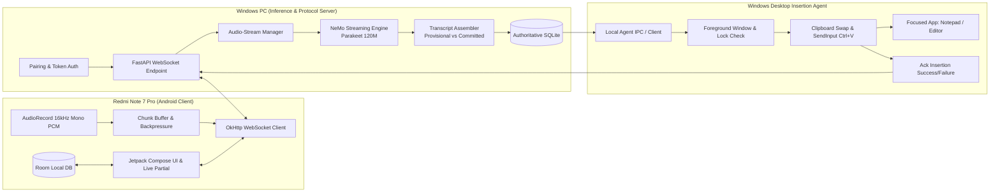

# Master Implementation Plan: PhoneMic LAN (Real-Time NVIDIA NeMo Voice Typing)

## 1. System & Hardware Baseline Verification

Environment probe executed on the host system:
- **Operating System:** Windows 11 Pro (Build 26200, 64-bit)
- **Host GPU:** NVIDIA GeForce GTX 1650 (Turing TU117, Compute Capability 7.5)
- **VRAM Total / Free:** 4096 MiB total / ~3056 MiB free (Display & UI processes currently utilize ~1040 MiB)
- **NVIDIA Driver / CUDA:** Driver 610.62, CUDA UMD 13.3, PyTorch runtime `2.14.1+cu126` (CUDA verified available)
- **System Memory:** 15,476 MB total RAM (~4,430 MB available)
- **Client Hardware:** Redmi Note 7 Pro (Snapdragon 675, Android 9/10/custom ROM)
- **Available Toolchains:** `python 3.11.9`, `uv 0.12.5`, `java 21 LTS`, `adb` (platform-tools), Android SDK (`C:\Users\RYZEN\AppData\Local\Android\Sdk`)

> [!WARNING]
> **4GB VRAM Constraint Notice:**
> The GTX 1650 provides 4GB of physical VRAM with ~3.0 GB usable after display manager overhead. 
> - **Candidate A (`nvidia/parakeet_realtime_eou_120m-v1` ~120M params):** Fits comfortably (~240–450 MB in FP16), leaving adequate headroom for streaming encoder state caches and CUDA context. **Selected as initial default candidate.**
> - **Candidate B (`nvidia/nemotron-speech-streaming-en-0.6b` ~600M params):** Will require 1.8–2.5 GB. It will be benchmarked under strict VRAM guardrails; if total allocation exceeds 3.1 GB, Candidate A remains the locked production default to prevent CUDA OOM.

---

## 2. Architectural Blueprint

---

## 3. Staged Implementation Roadmap

### Stage 1: Hardware & Inference Feasibility
- [ ] Create isolated Python environment using `uv` with pinned PyTorch CUDA and NeMo ASR packages.
- [ ] Implement standalone streaming inference feasibility script `scripts/benchmark_streaming.py`.
- [ ] Test Candidate A (`nvidia/parakeet_realtime_eou_120m-v1`) with simulated chunked PCM streaming (80ms–160ms chunks).
- [ ] Measure exact metrics: First-partial latency, Finalization latency, Peak VRAM utilization, Streaming cache persistence.
- [ ] Benchmark Candidate B (`nvidia/nemotron-speech-streaming-en-0.6b`) under the same test fixture with VRAM safety checks.
- [ ] Commit lockfile (`inference/uv.lock`) and feasibility test report.

### Stage 2: Windows Desktop Insertion Proof
- [ ] Implement isolated Windows desktop insertion module using `ctypes` / Win32 `SendInput`.
- [ ] Build clipboard manager: store previous clipboard, copy finalized text, simulate paste (`Ctrl+V`), and restore original clipboard state without overwriting concurrent user clipboard changes.
- [ ] Implement safety boundary checks: Verify desktop is not locked (`GetForegroundWindow`), target window is valid and not a secure credential field.
- [ ] Create automated integration test with `Notepad.exe`: launch Notepad, simulate input, verify Notepad document text, cleanly close Notepad.
- [ ] Deliverable: Zero-paste-duplication verified test suite.

### Stage 3: Local Server & Secure Protocol
- [ ] Implement FastAPI server with WebSocket streaming endpoint `/v1/stream`.
- [ ] Implement pairing protocol: 6-digit time-bounded enrollment code -> cryptographically random device token (stored hashed).
- [ ] Build packet protocol with sequence IDs, timestamps, frame validation (16kHz 16-bit mono PCM), and backpressure signals.
- [ ] Setup authoritative SQLite database with schema: `transcripts`, `sessions`, `insertion_logs`, `paired_devices`.
- [ ] Deliverable: Runnable server with mock inference passing all API unit tests.

### Stage 4: Android Microphone Client (`phonewire-android`)
- [ ] Setup Android project structure with Gradle version catalog (`libs.versions.toml`) targeting SDK 34 / minSdk 28 (compatible with Android 9+).
- [ ] Implement AudioRecord capturing 16kHz, 16-bit Mono PCM with ring buffer and amplitude normalization.
- [ ] Implement OkHttp WebSocket manager with reconnection backoff, heartbeat, and sequence ordering.
- [ ] Build Jetpack Compose UI:
  - Big microphone toggle button with recording state animation.
  - Real-time audio VU meter.
  - Live streaming partial transcript viewer.
  - Final transcript card with insertion status badge.
  - Settings screen (Server IP, Port, Pairing Code, Auto-insert toggle).
- [ ] Local persistence with Room SQLite for offline history.

### Stage 5: Live Streaming Transcription Pipeline
- [ ] Integrate NeMo streaming engine with the WebSocket incoming frame queue.
- [ ] Implement non-blocking queue feeding: Audio packets processed off the main WebSocket event loop.
- [ ] Implement Transcript Assembler:
  - Separate provisional hypothesis from committed tokens.
  - Word deduplication at chunk boundaries.
  - End-of-stream (EOS) flush handler to finalize audio and yield clean final text.
- [ ] Deliver live partials back over WebSocket with `<50ms` internal routing latency.

### Stage 6: Automatic Desktop Text Insertion Integration
- [ ] Wire server finalization directly to the Windows Desktop Agent.
- [ ] Flow: EOS received -> NeMo flush -> Final text committed to SQLite -> Agent signaled -> Focus check -> Clipboard paste -> Status returned over WebSocket to Android UI.
- [ ] Verify exact single insertion into active Notepad or editor instance without stealing window focus.

### Stage 7: Recovery, Hardening & Error Handling
- [ ] Network fault tests: Wi-Fi disconnection mid-sentence, packet drops, reconnect with session token.
- [ ] Prevent duplicate pastes: Each finalized transcript gets a unique UUID; Windows agent asserts idempotency before simulating keyboard events.
- [ ] Server restart recovery: Unfinished sessions flagged cleanly, completed transcripts intact in SQLite.
- [ ] Resource cleanup: Free NeMo encoder session caches on disconnect or stream completion.

### Stage 8: Local History & Optional Refinement
- [ ] SQLite search endpoint (`/v1/history?q=...`) and export (`TXT`, `JSON`).
- [ ] Conservative offline refinement pipeline: Punctuation restoration and capitalization rules (zero external cloud LLM dependencies).
- [ ] Android local history sync: browse past transcripts, manual "Re-insert" and "Copy" actions.

### Stage 9: Packaging & Acceptance Suite
- [ ] Android release APK build via Gradle.
- [ ] Windows orchestrator runner script (`run_server.ps1`).
- [ ] End-to-end automated verification runner testing all 15 acceptance criteria.
- [ ] Documentation: Reproducible setup, offline operation guide, and hardware limits documentation.

---

## 4. Specialized AI Agent Skills

To execute and govern this architecture with precision, 5 custom agent skills are established:

1. **`phonemic-inference-engine`**: NeMo streaming runtime, VRAM profiling on GTX 1650, chunked ASR caching, and benchmark harness.
2. **`phonemic-windows-agent`**: Win32 `SendInput` desktop insertion, clipboard preservation, foreground safety validation, and Notepad verification.
3. **`phonemic-server-protocol`**: FastAPI WebSocket streaming protocol, sequence ordering, token pairing, transcript assembler, and SQLite persistence.
4. **`phonemic-android-client`**: Android Kotlin/Compose client, AudioRecord 16kHz PCM streaming, OkHttp resilience, and Room database.
5. **`phonemic-e2e-validator`**: End-to-end integration test orchestrator, latency benchmarks, network interruption simulations, and acceptance reports.
